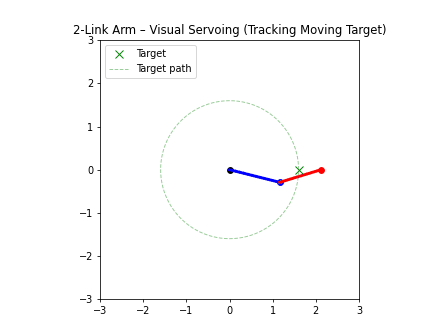
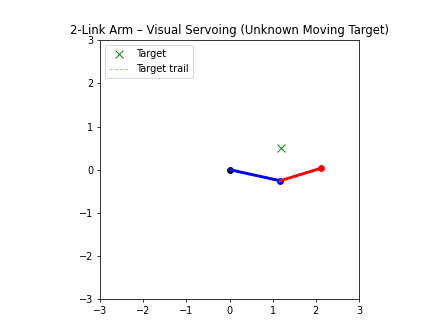

# 🎯 Visual Servoing: Camera-Guided 2-Link Arm (2D Simulation)

A 2-link robot arm tracks a moving target **using only what an overhead camera sees**.
Each control cycle the robot gets a noisy, delayed camera frame, finds the target with
OpenCV, maps the pixel to world coordinates with a calibrated homography, filters it with
a Kalman filter, and moves with a Cartesian step controller and analytic inverse kinematics.


*Left: world view. Green ✕ = true target, magenta ○ = what the robot believes, grey dots = raw camera measurements.
Right: the 150 ms-old camera frame the robot actually received, with its detection. Around t = 7 s a bar sweeps
across the view and hides the target; the filter keeps predicting and the arm stays on it.*

---

## 🧠 Pipeline

```
 target moves (unknown path)
        │
        ▼
 overhead camera renders a 640×480 frame        camera.py
   sensor noise · lighting flicker · mount vibration · clutter · occlusion · dropped frames
        │   …arrives 150 ms late
        ▼
 detect target in the image                       perception.py
   BGR→HSV · colour threshold · morphology · contours · area×circularity scoring · image moments
        │   (u, v) pixel centroid
        ▼
 pixel → world                                    perception.py
   homography estimated from a calibration image (cv2.findHomography)
        │   (x, y) metres
        ▼
 state estimation                                 kalman.py
   constant-velocity Kalman filter · chi-square outlier gate · coasts through dropouts
   · predicts 150 ms ahead to cancel camera latency
        │
        ▼
 Cartesian step controller  →  analytic IK  →  joint angles      visual_servo_controller.py, arm_math.py
        │
        └──────────── arm moves, camera sees the new scene ── loop every 50 ms
```

### The camera model
- Pinhole camera, `fx = fy = 400 px`, 640×480, mounted 4.5 m above the table with a few degrees of tilt
  and yaw (so the image is a real perspective view, not a scaled copy of the world).
- Because the arm and target lie on the plane z = 0, world ↔ pixel is a 3×3 homography `H = K [r1 r2 t]`.
- The robot never uses the true `H`. It **calibrates** it from an image of a 5×4 dot grid at known positions,
  like you would with a real camera. Mean calibration error: ~4 mm.

### Perception
- HSV colour threshold (red handled with two hue ranges), opening/closing to clean the mask.
- Contours are scored by `area × circularity`, so green clutter on the table and elongated shapes are ignored.
- Sub-pixel centroid from image moments. With noise and clutter: ~2 mm mean world error.

### Kalman filter
State `[x, y, vx, vy]`, white-acceleration process model, position-only measurements.
- **Smooths** detection jitter from sensor noise and camera shake.
- **Predicts through** dropped frames and occlusions.
- **Rejects outliers** with a 99.9 % chi-square gate on the innovation (and re-initialises if the track is truly lost).
- **Compensates latency**: the frame is 150 ms old, so the controller aims at `position + velocity × 0.15 s`.

---

## 📊 Results

Same target paths and the same camera noise for every estimator (5 seeds × 30 s, first 2 s ignored).
Camera: 150 ms latency, sensor noise σ = 8 grey levels, 1.5 px vibration, 5 % dropped frames, periodic occlusion.

**Random (unknown) target path**

| Estimator | RMS error | p95 error | Time within 5 cm |
|---|---|---|---|
| Oracle: true position, no camera (original sim) | 0.4 cm | 0.7 cm | 100 % |
| Raw camera detections | 5.7 cm | 9.7 cm | 54 % |
| **Camera + Kalman filter** | **2.7 cm** | **4.7 cm** | **96 %** |

**Circular target path**

| Estimator | RMS error | p95 error | Time within 5 cm |
|---|---|---|---|
| Oracle | 0.6 cm | 0.6 cm | 100 % |
| Raw camera detections | 8.4 cm | 10.8 cm | 1 % |
| **Camera + Kalman filter** | **2.3 cm** | **4.0 cm** | **99 %** |

The Kalman filter cuts RMS tracking error by **52 %** (random path) and **73 %** (circular path)
compared with feeding raw detections to the controller. Most of the gain comes from latency
compensation: with raw detections the arm always chases where the target *was*.

Reproduce: `python sim_visual_servo_camera.py --benchmark` (add `--target circular` for the second table).

---

## 📷 Live webcam mode

Hold a coloured ball in front of your webcam and the simulated arm follows it, using the same
detection → Kalman → controller → IK chain.

```bash
python webcam_tracking.py                  # green ball, default webcam
python webcam_tracking.py --color red --mirror
python webcam_tracking.py --video clip.mp4 --headless --out result.mp4
```
Keys: `q` quit · `k` toggle the Kalman filter (compare smooth vs jittery) · `m` show the colour mask.

---

## ▶ Running

```bash
pip install -r requirements.txt

python sim_visual_servo_camera.py                         # camera in the loop, Kalman, random target
python sim_visual_servo_camera.py --estimator raw         # no filter: watch it lag and jitter
python sim_visual_servo_camera.py --target circular --latency 5 --noise 15
python sim_visual_servo_camera.py --save-gif assets/sim_visual_servo_camera_kalman.gif
python sim_visual_servo_camera.py --benchmark

pytest -q                                                 # 10 tests: IK, projection, calibration,
                                                          # detection, Kalman, closed loop
```

The original perfect-information simulations are still here for comparison:

```bash
python sim_visual_servo_moving_circular_target.py
python sim_visual_servo_moving_unknown_target.py
```

### Live browser demo
**▶ [astitwaroy.github.io/Visual-servoing-2D-arm-simulation](https://astitwaroy.github.io/Visual-servoing-2D-arm-simulation/)**

`index.html` runs the whole camera pipeline in the browser: a simulated 320×240 overhead camera,
colour-blob detection, homography calibration from a dot grid, and the Kalman filter.
Switch between *Perfect info*, *Raw camera* and *Kalman filter* to watch the arm lag and jitter
without the filter, change delay / noise / shake / dropped frames, drag the ball around, and run a
30 s benchmark of all three estimators on the same path and noise.

---

## 📂 Project structure

```
├── arm_math.py                     forward & inverse kinematics, 2-link planar arm
├── visual_servo_controller.py      proportional Cartesian step controller with step limit
├── target_motion.py                circular and random-walk target generators
├── camera.py                       pinhole camera model, homography, frame renderer with noise
├── perception.py                   HSV detection, pixel→world, homography calibration
├── kalman.py                       constant-velocity Kalman filter with outlier gating
├── servo_pipeline.py               closed loop: camera → detection → filter → control → IK; metrics
├── sim_visual_servo_camera.py      visualisation, GIF export, benchmark CLI
├── webcam_tracking.py              live webcam / video-file tracking
├── sim_visual_servo_moving_circular_target.py   original sim (true position, circular path)
├── sim_visual_servo_moving_unknown_target.py    original sim (true position, random path)
├── index.html                      browser demo (camera, detection, Kalman, benchmark)
├── tests/test_pipeline.py
└── assets/                         GIFs
```

---

## 🦾 Robot arm model

```
(base) ── L1 = 1.2 m ── (elbow) ── L2 = 1.0 m ── (end effector)
```
Closed-form IK, elbow-up by default. Reachable workspace: 0.2 m ≤ r ≤ 2.2 m. If the commanded
point is unreachable, the arm holds its last pose.

## 🔎 Scope and next steps

This is **position-based** visual servoing: the image is turned into a world position, and control
happens in Cartesian space. Natural extensions:
- **Image-based visual servoing (IBVS)**: drive the joints directly from the pixel error using the image Jacobian.
- **Eye-in-hand camera** mounted on the end effector instead of a fixed overhead camera.
- **Learned detector** (e.g. a small CNN) for targets that colour thresholding can't separate.
- **Full camera calibration** (intrinsics + lens distortion) with `cv2.calibrateCamera` on a real checkerboard.

## 📸 Original simulations (perfect target information)

| Circular target | Unknown target |
|---|---|
|  |  |
